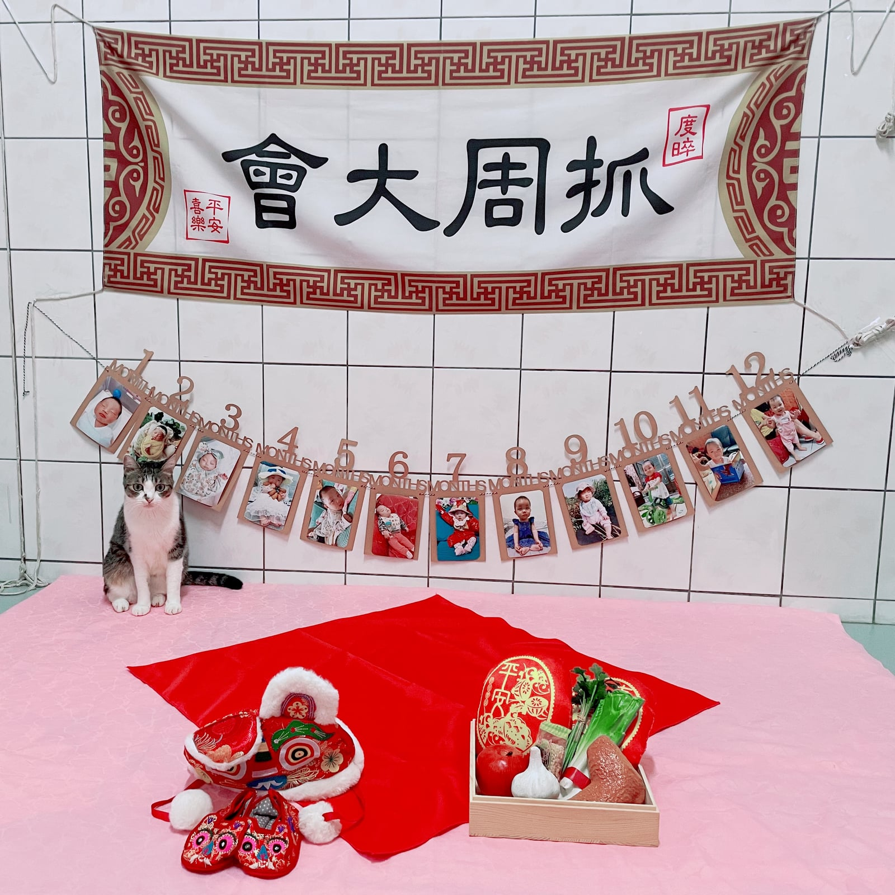
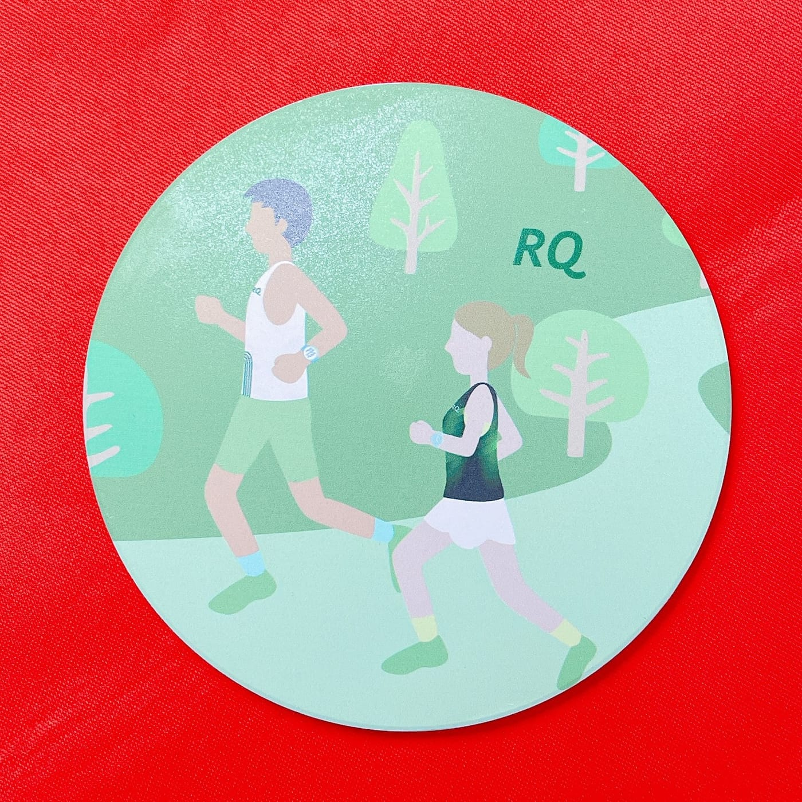
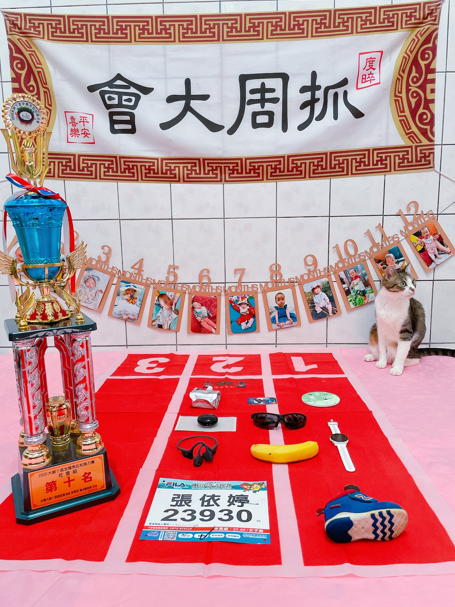

宅在家裡全力防疫的同時，寶寶不知不覺滿一歲了，已經決定每個儀式都要過好過滿的我們，眼看著無法到抓周會館來場傳統儀式小旅行，就決定租一套抓周古禮大全套，直接在家舉辦。就讓我紀錄這場特別的線上「桐桐抓周大會」吧。

我們省略了祭拜祖先，僅就有進行的祝福儀式以及抓周儀式紀錄並分享。

## 場景服裝準備

場景佈置除了有租來的抓周大旗外，還印出桐桐從出生到一歲每個月的精選照片作為背景。活動儀式要挑選的吉時，就是寶寶吃飽睡好心情好之時，先觀察寶寶與家人們的起居作息，挑了個晚餐後的活力充沛時段。服裝挑選上就是一大難題了，桐寶寶怎麼穿都可愛，就讓老婆決定吧！

## 祝福儀式

（這裡原本有一張桐桐露臉的照片，為了保護她的隱私，搬家時先拿掉了。）

傳統禮俗會需要一些食物，疫情期間不方便購買，也有衛生上的考量，我們就直接使用租來的玩具食物們，消毒後直接進行祝福囉！

1\. 腳踩紅龜粿：平安喜樂又長壽。\
2\. 吃大雞腿：不愁吃穿。\
3\. 吃大蘋果：凡事平平安安。\
4\. 吃米香：臭嘴去，香嘴來。\
5\. 抱蔥：能聰明伶俐。\
6\. 抱芹菜：能勤奮向上。\
7\. 抱蒜：能精打細算。\
8\. 敲響智慧鑼：第一聲智慧增長；第二聲及第登科；第三聲財運興旺。

（這裡原本有一張桐桐露臉的照片，為了保護她的隱私，搬家時先拿掉了。）

敲智慧鑼原本想要協助她，沒想到居然完全不用擔心，她拿到棒子就自己狂敲鑼。而其他的儀式流程，除了腳踩紅龜粿我們有特別抱寶寶起來外，其餘的祝福物品都放在一盆，給桐寶寶自己玩耍，我就在一旁逐一念祝福的話語，希望桐桐在這充滿新挑戰的世界裡，寫下屬於她的人生故事。

## 勇闖聰明門

（這裡原本有一張桐桐露臉的照片，為了保護她的隱私，搬家時先拿掉了。）

聰明門架設比較麻煩，所以我們提前在下午先進行。身為戴不住虎帽、穿不了虎鞋的寶寶，全身僅穿肚兜虎裝，用桐媽手作餅乾當引子，立刻超迅速地闖關聰明門成功！

## 抓周儀式

（這裡原本有一張桐桐露臉的照片，為了保護她的隱私，搬家時先拿掉了。）

古禮大全套總覺得少了一些專屬於我們的特色，既然連婚禮都用一場路跑賽事為主軸了，那抓周也來嘗試看看。先精選出 12 個行業別，再以「跑步」為主軸，一一挑選搭配出最符合的小物，最終定案版如下：

**1. 金融業（銀行、理財、保險等） — 信用卡**

**2. 旅行探險業（旅行社、考古冒險等） — 跑鞋**

行萬里路始於足下，別有寓意。

**3. 科技業（軟硬韌體工程師、新鮮的肝等） — 嘎米手錶**

用鍵盤已經太落伍了，相信不久的將來肯定是用嘴打字，而手錶這種穿戴配件，除了科技之外，更重要的時尚穿搭以及象徵啊！

**4. 音樂產業 （KKBOX、歌手、音樂家等） — 運動耳機**

在 AirPod Pro 與 AfterShokz 骨傳導耳機之間考慮蠻久的，最終選定看起來比較耐摔，也不容易誤食的耳機。

**5. 研究業（科學家、教授等） — STRYD**

最能代表運動科學家研究結晶肯定是 STRYD – 跑步功率計，讓跑步科學化訓練邁入下一個世代，超適合時間有限且重視效率的市民跑者們，也是花大把時間金錢代理來台灣的主要原因。

**6. 醫療健保（醫護藥等） — 撒隆巴斯**

**7. 公務體系（政治家、公務人員等） — 號碼布**

大家可能會覺得號碼布跟公務體系關聯性不大，但其實每一場路跑賽事都必須要政府核准才可以舉辦，大型的活動並不是隨便就可以辦的！

**8. 藝術設計業（畫家、設計師等） — RQ 杯墊**

這是我們的獨家產品，也是我們設計最滿意的成品之一，此杯墊目前只提供給 RQ 內部團隊與股東們，非賣品，這次特別拿出 2 個，送給猜對抓周物品的親朋好友們。

**9. 社會安全（軍警消等） — 墨鏡**

感謝有你們維護社會安全與秩序，就是帥！

**10. 農林漁牧（農夫、漁夫等） — 香蕉**

**11. 餐飲營養業（廚師、營養師等） — 補給包**

**12. 體育業（選手、教練等） — 獎盃**

原本想使用老婆第一次上凸台的木製獎盃，因為私心想讓她多注意，木製獎盃不夠繽紛也不夠大，最後採用 RQ 選手們與教練首次組團參加 2020 大腳丫接力賽，獲得第十名的超浮誇巨型獎盃。

有看出來嗎？這 12 樣物品，剛好就組成一場路跑賽事的整個流程啊！

刷卡報名一場路跑賽事後，決定要開始認真練跑步，第一個買的就是跑鞋。跑著跑著發現怎麼大家手上都有嘎米手錶，二話不說立刻購入。慢慢加入長跑需要來點配樂，真無線運動耳機會成為你的最佳夥伴。

練一段時間發現很容易被刷卡，想要更高效訓練，購入 STRYD 功率計。練太多了需要加速恢復使用撒隆巴斯。

終於等到選手物資寄來了，除了有號碼布外，還有各種特色禮品（RQ 杯墊其實有打算在合作的湖口老街半馬上贈送，可惜因為疫情停辦了）。

為了想要在比賽時，被拍到的都是好照片，而不是猙獰或是無神的表情，用墨鏡把眼睛遮起來就沒問題。賽場上補給站最常出現的香蕉，加上自備的補給包，通過終點線拿下努力得來的獎盃。

（這裡原本有一張桐桐露臉的照片，為了保護她的隱私，搬家時先拿掉了。）

介紹完這 12 項跑步版物品後，就要來正式開始抓周啦！我們為了獎盃，稍微調整一下規則，只要桐桐單獨連續觸碰該項物品 5 秒以上就算數。

果然愛吃是寶寶的天性，從跑道起點出發後，直奔香蕉而去，抓住後就不肯放了，第一個代表行業就大爆冷門的農林漁牧業。該不會是我們搬回雲林住在田野中，她就想乾脆直接找塊農地來耕作了。

抽掉香蕉後，寶寶第二項物品好似已經選定般，一手直接抓起運動耳機。在活動前有舉辦猜行業活動，寶寶果然不負眾望，最高票的音樂產業代表物，就這樣被寶寶抓起來啦！哇，我要成為星爸了嗎？

在我們還在聊第二項物品時，忽然寶寶伸手去抓 STRYD，養妳一年多果然不是白疼的，還在想要怎麼介紹的時候，又丟下 STRYD，開始在各物品中游移，在經過墨鏡、號碼布、獎盃後，最終選定的是補給包，完全出乎我的意料之外，第三個代表行業就是餐飲營養業。

「先顧肚子再顧音樂創作，創作完再補給一下，有前途！」聽完國峰的解說，果然是很務實又充滿理念的寶寶呢。

## 手摸福虎

（這裡原本有一張桐桐露臉的照片，為了保護她的隱私，搬家時先拿掉了。）

此環節是安排讓棲碧姐姐擔任福虎的重責大任，不過，我去抱過來就已經在生氣了，只好啟用備案，拿福虎娃娃來讓桐桐摸摸，做最後結尾。

摸虎頭 - 長大會出頭\
摸虎耳 - 健康吃百二\
摸虎嘴 - 大富又大貴\
摸虎肚 - 貴人來相助\
摸虎腳 - 家貨吃味乾\
摸虎尾 - 賺錢存傢伙

## 參考資料

我們租用的是[橙寶樂園的傳統古禮抓周組](https://www.orange-ya.com/product.php)，儀式流程也是以他們提供的為主；AfterShokz 骨傳導耳機感謝[飢餓傻瓜](https://www.facebook.com/ImHungryFoolish)贊助；感謝東華資工最美助理 kiki 贊助超可愛的跑鞋；[STRYD](https://www.stryd.tw/) 是我們公司代理的產品。

嘎米、撒隆巴斯與威x果凍沒有贊助，都是自己買的，哈。

（這裡原本有一張桐桐露臉的照片，為了保護她的隱私，搬家時先拿掉了。）

送給看到最後的你一張本日主角清涼照！
