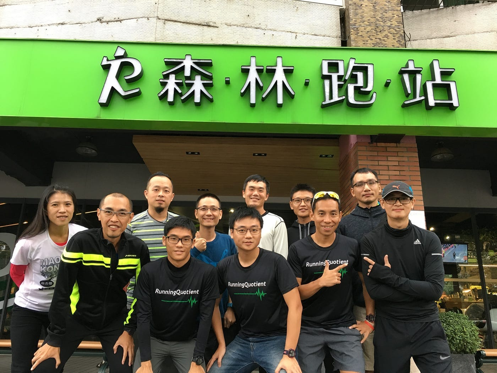
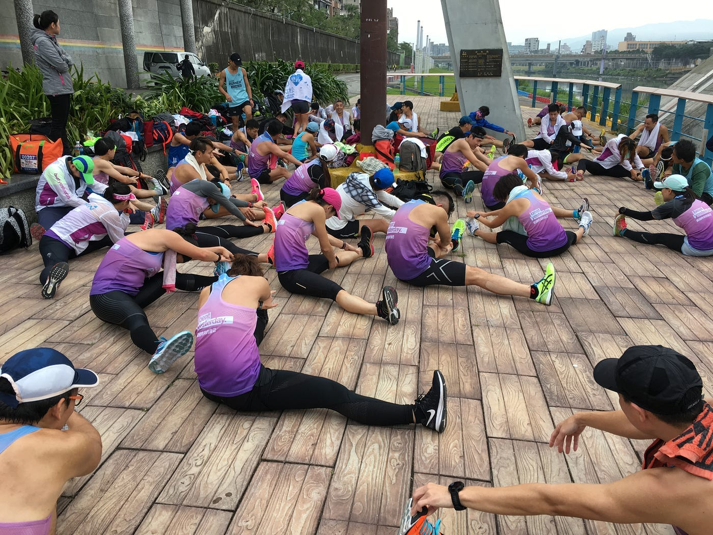
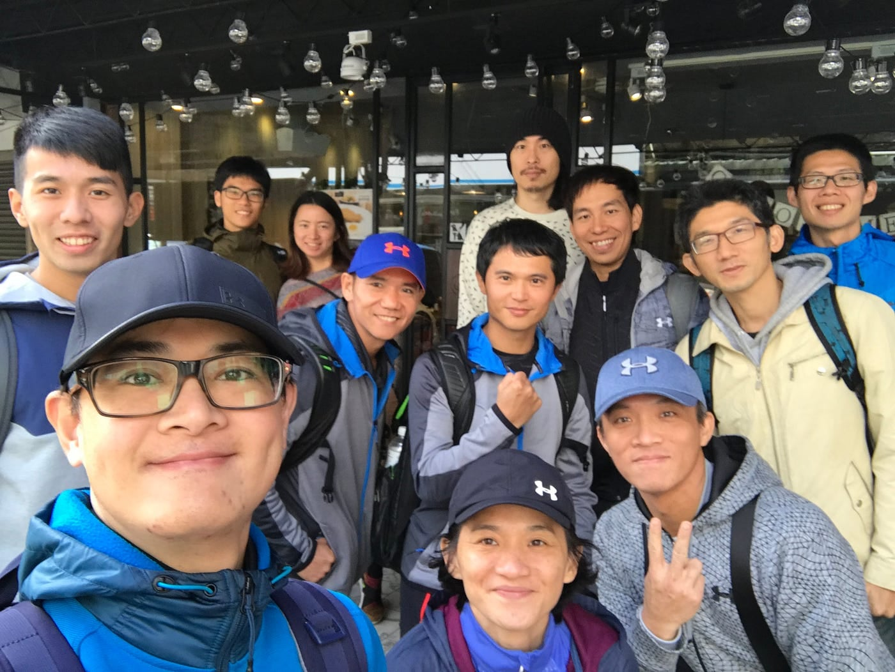
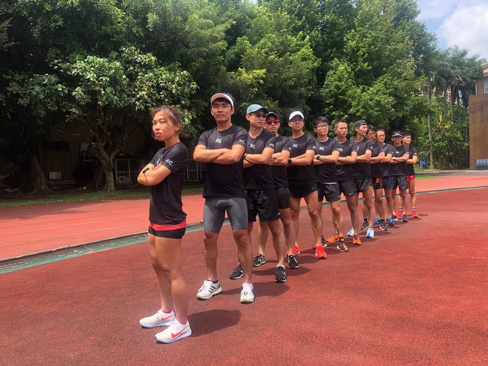
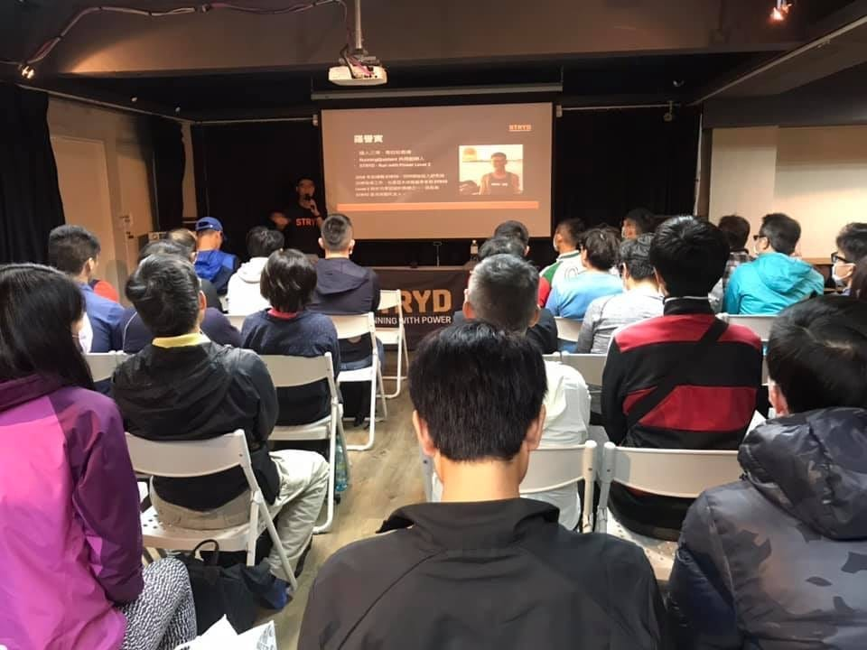
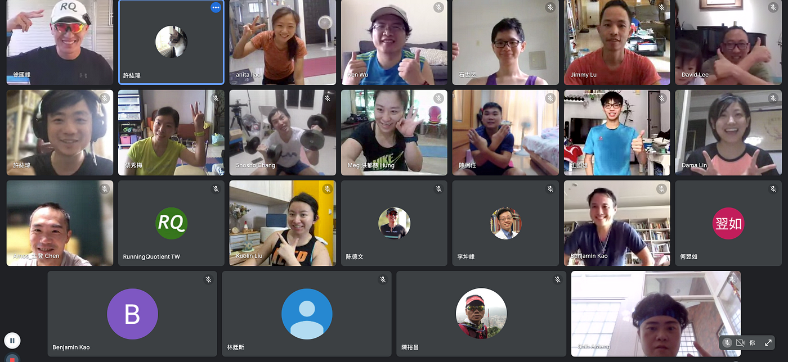
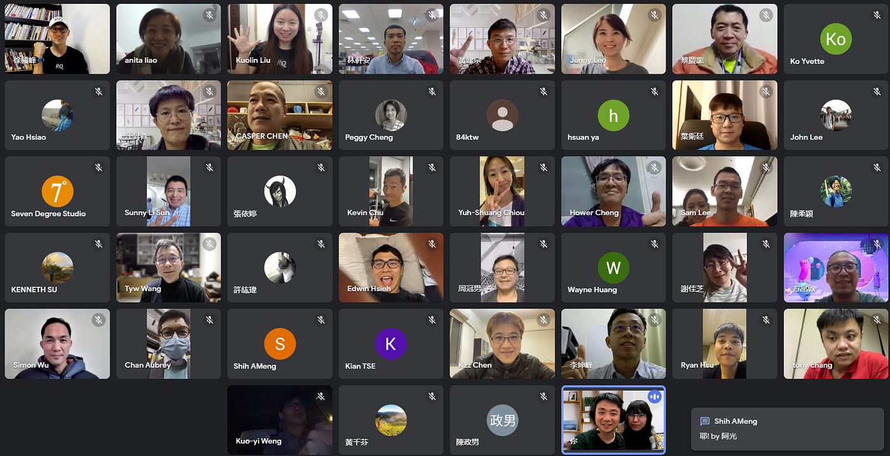

這些年 RQ 陪伴著跑者一起成長，也滿 6 歲了！

掌握著成長與進化方向的舵手，其實不是身為 CEO 的我，而是熱愛跑步的你。怎麼說呢？就聽我娓娓道來。

2016年，那時跑錶能蒐集的數據越來越多，但是對大多數跑者來說，不過就是數字罷了。市面上訓練計畫琳瑯滿目，但卻沒有一個專門幫跑者解釋數據的服務，因此我們創立了 RQ，用最直覺的「跑力」，帶出一系列的科學化訓練分析，從表現、體能、技術數據中，堆疊了更進一步的資訊，幫助你在吃課表的同時，能快速發現自己的不足、看見自己的進步。當時，我們每月還會抽出幸運兒，由國峰或譽寅教練一對一解釋你的跑步數據呢。

*2016 年一對一線上教學經驗分享會*

2017年，冷冰冰的數據分析少了些溫度，難不成跑者只能是孤獨的嗎？常聽到「一個人可以跑得快，但一群人能跑得遠」，當大家擁有共同目標賽事，能一起品嘗教練開的課表，在賽道上同時鳴槍起跑，毫無保留地奔向終點，此時，陪著我們一起成長的數據，瞬間變得更有意義。那時合作舉辦了不少訓練營，像是 Garmin 全馬 PB 班、UA 鬥士挑戰營與 Leader 跑班等，回想起來總會感到暖暖的，那時結交的朋友，依然很常出現在 FB 上呢。

*2017 年 Garmin 全馬 PB 班最後一次團練*

2018年，跑班蓬勃發展下，我們注意到了有一群人，熱愛跑步卻無法實地參與，可能是因為時間不好配合，或是被居住的地點束縛，很難享受到跑步訓練服務。而 RQ 再次進化了跑力與各數據分析演算法，讓教練們從後台即可準確掌握訓練品質，順勢推出了 RQ 一對一「線上」教練服務。只要你想訓練，時間與地點再也限制不了你。啊，也是因為這服務，才讓我認識了好朋友冰冰姐呢！

*2018 年跑步教練聚會*

2019年，許多跑者對一對一線上教練服務還很模糊，擁有豐富經驗的 羅譽寅 LO U IAN 教練，便提出了 RQ project，直接徵招願意訓練的市民跑者，提供完整一對一線上教練服務，並將所有訓練內容公開，讓你我可以像是實境秀般，觀看這些跑者的課表、數據變化。每位來報名的跑者都很優秀，而 鴻鵠之志 — 江承鴻 、 張恪銘 CHANG KE MING 和 風馳米漿 — 蔡明霖 成為第一屆 RQ 贊助市民跑者，雖然此計畫目前暫時擱置，但我相信這絕對不會是最後一屆。同年，RQ 也贊助了相當有潛力的選手 逐日奇譚 — 李奇儒，一起合作至今。

*2019 年第一屆 RQ project 市民菁英培訓營*

2020年，研究功率訓練好幾年的譽寅教練，在他的學員與他身上，都獲得相當不錯的成效，國外跑圈相當有話題性、且至今仍是最精確的跑步功率計 STRYD ，卻很難在臺灣買到。為了讓跑者有更多選擇，我們也投入經費獨家代理了 STRYD 來臺，並提供比原廠更久的售後服務，同時 RQ 開始導入功率數據，也陸續加入功率分析開發。那年，國內外知名賽事陸續停辦下，對更有效訓練的渴望降低不少，除了 RQ 受疫情影響，我也受到人生至今最大的衝擊，老婆產後大出血，還好一直有強迫不運動的她跑步，缺氧狀態已在比賽時體驗過，難不倒她。這年，讓我更下定決心，將「推廣有氧訓練」當成這輩子的志業。

*2020 年 STRYD 跑步功率課程*

2021年，無論再怎樣小心翼翼，臺灣還是被病毒找到突破口，為了不讓你辛苦訓練累積白費，警戒升溫時，立刻邀請核心教練們開始一系列的線上課程合作，有 徐國峰 HSU KUO FENG 教練為主的跑者關鍵力量、原地跑直播與 KFCS 跑步教練培訓課程，還有 IR Sports 跑創運動 余文彥 Wen-Yen Yu 教練主導的全方位徒手訓練與主動恢復課程，年底， Coach Hank 陳政翰 教練也加入了全線上的決戰台北馬拉松訓練系統。

*2021 年徐國峰跑者專項線上力量課程*

2022年，我們與國峰教練合作的線上訓練營，契合了不少跑者的需求，想要有一群單純吃課表的線上夥伴，在沒有實體課程下，你可以是中和飆仔、可以當東湖人妻、可以叫秋名山滔滔，變得有點像線上遊戲般，擁有自己的網路身份，往目標賽事一起邁進。目前正在進行的 5K 線上訓練營中，也有許多同學都已經報名年底的徐國峰全馬初馬/破4訓練營呢。

*2022 年徐國峰 5K 飆速線上訓練營*

接下來，RQ 還會一直前進。方向，依然會是由熱愛跑步訓練的你們決定。

而你是哪時期加入 RQ 的呢？

還沒加入？那你現在成為跑者，絕對是最好時機喔。一起用訓練打造更強韌的自己吧！
